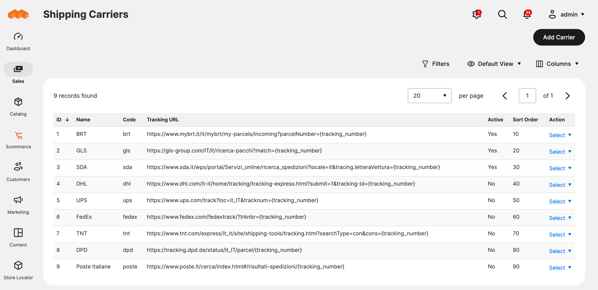
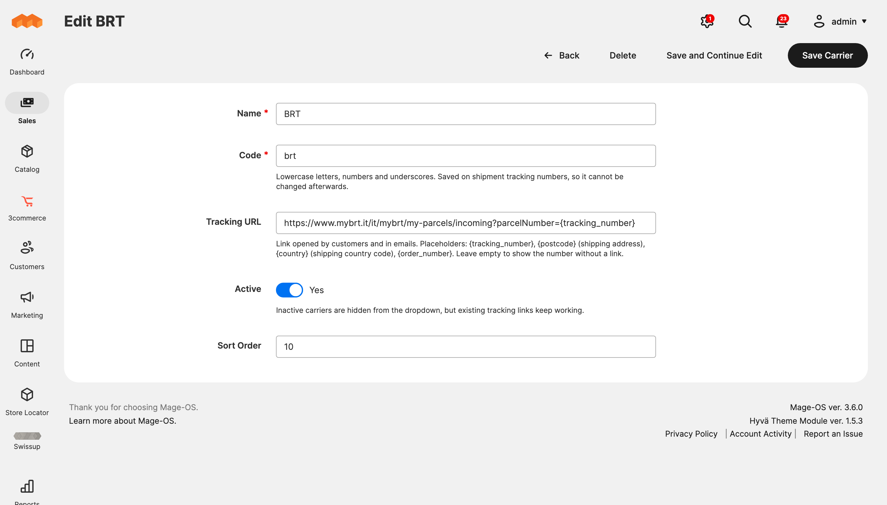
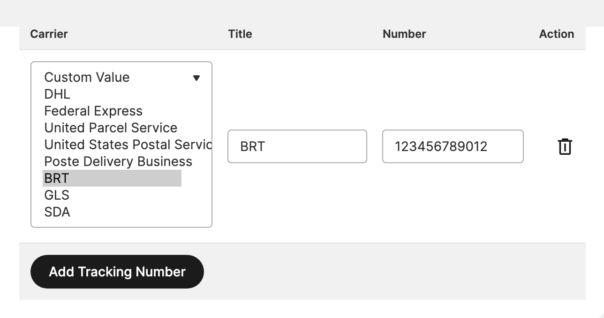

# Threecommerce_ShippingCarriers: your own carriers and tracking links for Magento 2 / Mage-OS

Manage your own list of carriers (BRT, GLS, SDA...) in the admin. They appear in the carrier dropdown when you add a tracking number to a shipment, and the tracking number links straight to the carrier's tracking page in emails, order pages and the admin.



**Compatibility:** Magento Open Source / Adobe Commerce 2.4.4 – 2.4.9 · Mage-OS 1.x / 3.x · PHP 8.1 – 8.4 · Themes: Luma, Hyvä, Breeze
**License:** free · **Current version:** see [Releases](../../releases)

## Features

- **Admin grid** under Sales → Operations → Shipping Carriers: name, code, tracking URL template, active flag and sort order.
- **Add tracking:** active carriers show in the carrier dropdown of "Add Tracking Number" on the shipment page and the title is filled in automatically.
- **Links** to the carrier page in shipment emails, order and shipment pages (Luma, Hyvä, Breeze) and the admin; the store tracking popup shows the link too.
- **URL placeholders:** `{tracking_number}`, `{postcode}`, `{country}` (shipping address) and `{order_number}`, URL-encoded.
- Nine common Italian carriers are created inactive on install: enable the ones you use and check their URLs.
- Carriers from other modules (UPS, FedEx...) configured in Stores → Configuration keep working as before.





## Requirements

- Magento Open Source / Adobe Commerce 2.4.4+ or Mage-OS
- PHP 8.1 – 8.4
- Magento modules: Backend, Sales, Shipping, Ui

## Installation

The package is distributed through our Composer repository at `repo.threecommerce.it`. Request the credentials from the [product page](https://www.threecommerce.it/corrieri-tracking-spedizioni-magento-2?utm_source=github&utm_medium=readme&utm_campaign=magento2-shipping-carriers-tracking), then:

```bash
composer config repositories.threecommerce composer https://repo.threecommerce.it
composer require threecommerce/m2-shipping-carriers
bin/magento module:enable Threecommerce_ShippingCarriers
bin/magento setup:upgrade
bin/magento cache:flush
```

## Configuration

Admin → **Sales → Operations → Shipping Carriers**. The carrier `code` is stored on the shipment track, so it cannot be edited after creation. Deleting a carrier keeps old tracking numbers but they lose the link: disable it instead.

## Documentation and support

- Product page: [threecommerce.it/corrieri-tracking-spedizioni-magento-2](https://www.threecommerce.it/corrieri-tracking-spedizioni-magento-2?utm_source=github&utm_medium=readme&utm_campaign=magento2-shipping-carriers-tracking)
- [Changelog](CHANGELOG.md) (in Italian)
- Support and custom development: [threecommerce.it/contatti](https://www.threecommerce.it/contatti?utm_source=github&utm_medium=readme&utm_campaign=magento2-shipping-carriers-tracking)

---

*This repository is the public showcase of the module. The source code is kept in a private repository.*
